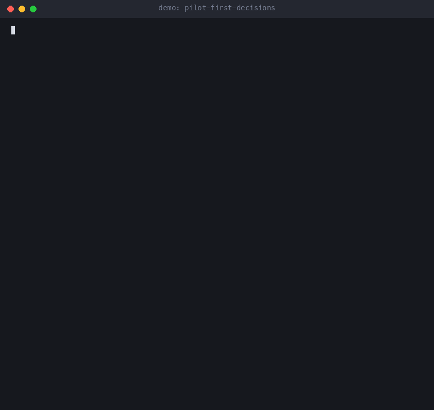

# pilot-first-decisions

**Stop paying a chat model to answer yes/no. A recipe and a benchmark harness for decision models.**



Many LLM calls in production are not "write something". They are "decide something": is this message angry, which topic is it, is the brand mentioned, how urgent is it. A chat model does these fine, but you pay for a full generation and wait for it. A decision model returns the answer as probabilities with a confidence, and it is built for exactly this job.

This repo has two small scripts, no dependencies, Node 18 or newer:

- `decide.mjs`: a client for the OpenRouter decisions endpoint. Many questions about one text in one request.
- `bench.mjs`: runs the decision model and a chat model of your choice on the same rows and tells you where they agree, where they don't, what each costs, and whether a hybrid setup is worth it.

The recipe is the order of work: **pilot first, compare by eye, then route by confidence.** Don't switch a production call because a vendor page says it is cheaper. Run 20 rows, read the disagreements, then decide.

## Example prompts

- "Check whether a decision model can replace my chat model for tagging support messages as angry or not."
- "Run the pilot on examples/support-messages.jsonl in fixture mode." Makes no network calls and needs no key.
- "Compare costs on 20 of my rows and show the disagreements." Sends those 20 rows to OpenRouter. See [Data sent](#data-sent).

## When to use it

Good fit:

- Classification: tone, topic, intent, category.
- Yes/no checks: spam, mentions a deadline, needs a human, should this step run.
- Scoring on a short scale: urgency, relevance, quality.
- Picking the best of N candidates.
- A cheap filter in front of an expensive model, so the big model only sees rows that pass.

Bad fit:

- Text generation. A decision model does not write.
- Arithmetic, counting, dates, pulling numbers out of text.
- Images, audio, video. Text only for now.
- Inputs over 32k tokens.

## Quick start

```bash
git clone https://github.com/nickspiz/pilot-first-decisions
cd pilot-first-decisions
# put your own OpenRouter key in the OPENROUTER_API_KEY environment variable
# and never write it into a file in this repo
npm test                        # no network needed
```

See what a report looks like first. This replays invented answers, so it needs no API key and costs nothing:

```bash
node bench.mjs --fixture examples/fixture.json \
  --data examples/support-messages.jsonl \
  --questions examples/questions.json \
  --confidence-threshold 0.8 --limit 60
```

Those numbers are made up and say nothing about any model. `scripts/make-fixture.mjs` shows how they are made.

You can also install it as a Claude Code plugin, which adds a skill and the script:

```text
/plugin marketplace add nickspiz/pilot-first-decisions
/plugin install pilot-first-decisions@pilot-first-decisions
```

Ask a few questions about one text:

```bash
node decide.mjs --text "I was charged twice and nobody replied." --questions examples/questions.json
```

Run the pilot. The default is 20 rows, so a first run is small. Check your chat model's price before you raise the limit:

```bash
node bench.mjs \
  --data examples/support-messages.jsonl \
  --questions examples/questions.json \
  --chat-model openai/gpt-4o-mini \
  --confidence-threshold 0.8
```

Pass `--limit 60` or `--limit all` only after you have read the first report.

### Question spec

A JSON object, one entry per question. Three types:

```json
{
  "angry":   { "type": "noul",   "instructions": "Is the customer angry?" },
  "topic":   { "type": "choice", "instructions": "What is it about?",
               "criteria": { "bug": "something is broken", "billing": "payments" } },
  "urgency": { "type": "score",  "instructions": "How urgent is it?",
               "criteria": ["low", "medium", "high"] }
}
```

- `noul`: a probability of yes between 0 and 1. The client turns it into `yes`/`no` and a confidence.
- `choice`: picks one key from `criteria`, with probabilities and a confidence.
- `score`: a number on the scale, mapped to the nearest label.

### Input files

CSV or JSONL, one row per item. The text column is `text` (change it with `--text-field`). Optional columns named `expected_<question>` hold your own labels, and the report then shows accuracy for each side as well as their agreement.

### Options

| Option | Default | Meaning |
|---|---|---|
| `--limit` | 20 | Rows to run. `all` for everything. |
| `--confidence-threshold` | off | Hybrid mode: decision answers below this confidence are replaced by the chat answer. |
| `--chat-model` | required | Any OpenRouter model id. |
| `--decision-model` | `typesafe/jev-1.13` | Decision model id. |
| `--concurrency` | 4 | Parallel rows. |
| `--out` | `bench-out` | Where `report.md` and `results.json` go. |
| `--fixture` | off | Replay canned answers from a file instead of calling any API. No key needed. |

For `noul` questions, confidence is how far the probability is from 0.5, scaled to 0..1.

## What the report looks like

The layout below is illustrative. The numbers are invented to show the shape, they are not a measurement.

```
## Cost and latency
|          | Total cost | Per 100 rows | Median latency |
| Decision | $0.00040   | $0.00200     | 380 ms         |
| Chat     | $0.00500   | $0.02500     | 900 ms         |

## Agreement
| Question  | Agreement | N  | Hybrid agreement | Routed to chat |
| sentiment | 80.0%     | 20 | 90.0%            | 25.0%          |
| topic     | 95.0%     | 20 | 100.0%           | 10.0%          |

## Confusion matrix: sentiment      (rows: chat, columns: decision)
## Disagreements
- row 7: chat=negative, decision=neutral (confidence 0.41) "The refund you promised..."
```

`results.json` keeps every raw answer, so you can slice it yourself.

## Numbers from one pilot

In one pilot of 100 rows (tone of brand mentions in real answers, three classes), the decision model agreed with a chat model on about 70% of rows. It cost about $0.003 per 100 calls, with a median latency of about 0.35 s. It rarely mixed up positive and negative, but it leans toward "neutral": most of the rows the chat model called negative came back neutral. That is why the confidence threshold exists. Treat these as one data point on one task, not a benchmark. Disagreement is not the same as error, since the chat model is not ground truth either. Run your own rows.

## Data sent

When you run `decide.mjs` or `bench.mjs` without `--fixture`, the scripts send data to openrouter.ai. That is a third-party service, not run by the author. Your row text leaves your machine.

- **To `https://openrouter.ai/api/alpha/decisions`** (decision model): the text of each row, your question spec, and the model id.
- **To `https://openrouter.ai/api/v1/chat/completions`** (the chat model you name with `--chat-model`, benchmark only): the text of each row, the questions, and the model id. OpenRouter passes the request on to the model provider.
- **In the `Authorization` header of both:** your OpenRouter API key.
- **Nothing goes to the author.** There is no telemetry and no other server.
- Use rows you are allowed to share with OpenRouter and the model providers. OpenRouter's privacy policy: https://openrouter.ai/privacy

Fixture mode (`--fixture`) and `npm test` make no network calls.

**Where results go.** `bench.mjs` writes `report.md` and `results.json` to the folder you pass with `--out` (default `bench-out/`, relative to where you run it). `results.json` keeps every raw answer, so treat it as data from your input rows. `decide.mjs` prints to the terminal and writes no files.

**The API key.** The plugin declares the key as a sensitive plugin option (`openrouter_api_key`), so Claude Code can ask for it and store it in the system credential store instead of a settings file. The scripts read `OPENROUTER_API_KEY` first and `CLAUDE_PLUGIN_OPTION_OPENROUTER_API_KEY` second. Claude Code does not pass plugin options to commands that Claude runs through the Bash tool, so for runs started by Claude, export `OPENROUTER_API_KEY` in the shell you start Claude Code from. The key is only ever sent to openrouter.ai, and the scripts never write it to a file.

**Alpha endpoint.** The decision endpoint is `/api/alpha/decisions`. It is an alpha API and the model `typesafe/jev-1.13` is in beta and not in the public OpenRouter model list. Its response shape, price or availability can change without notice. Pin the model id and keep the chat model as a fallback.

## Privacy

What the plugin runs: one skill that tells Claude to run `bench.mjs` (Node 18+, no dependencies) on files you point it at. What it reads: your input file (CSV or JSONL), your question file, and the API key. What it writes: `report.md` and `results.json` in the `--out` folder. What it sends: see [Data sent](#data-sent).

## Honest notes

- The decision model is in beta. The endpoint is `alpha`, the model is not in the public OpenRouter model list, and the response shape or pricing can change. Pin the model id and keep the chat model as a fallback.
- Cost figures come from the `usage.cost` field each endpoint returns. Check your OpenRouter dashboard before you scale up.
- Hybrid mode in `bench.mjs` needs the chat answer for every row to measure it. In production you would call the chat model only for the routed share, which is the point.
- The example data is synthetic: 60 invented support messages. No real user data is in this repo.

## Tests

```bash
npm test
```

Covers answer parsing, request shape, CSV and JSONL loading, agreement, confusion matrix, hybrid routing, and the report. Fetch is mocked, so tests never touch the network.

## Questions and ideas

Have a question or an idea? Start a [discussion](https://github.com/nickspiz/pilot-first-decisions/discussions). For bugs, open an [issue](https://github.com/nickspiz/pilot-first-decisions/issues/new/choose). See [CONTRIBUTING.md](CONTRIBUTING.md) before sending a pull request.

## Support

Questions or bugs: [GitHub Issues](https://github.com/nickspiz/pilot-first-decisions/issues) or hello@nickspiz.com.

## License

MIT
